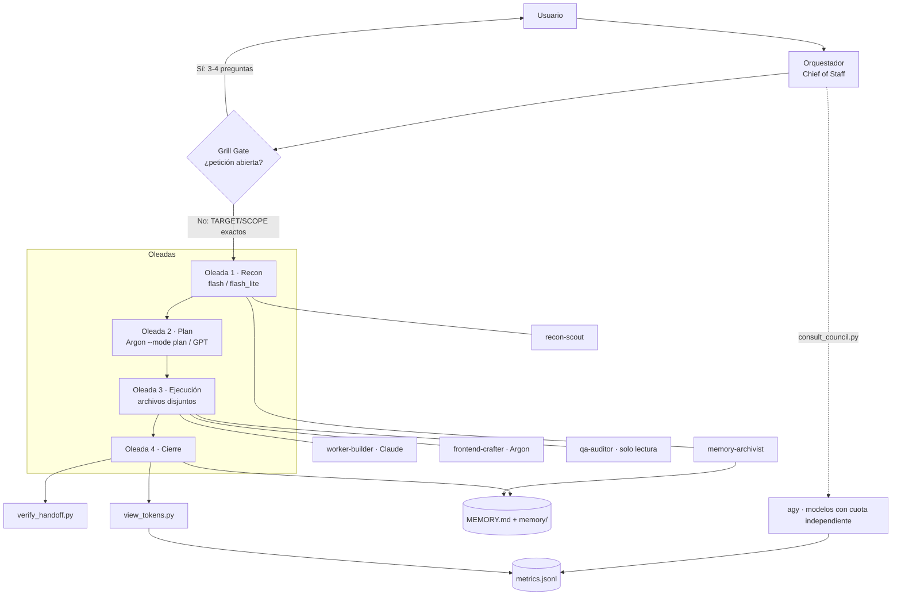

# 🎖️ Chief of Staff

> Plugin de orquestación multi-agente para **Antigravity CLI (`agy`)**: un orquestador ligero que reparte el trabajo entre modelos con **cuotas independientes**, protege su propia cuota y exige verificación determinista en cada entrega.

[](LICENSE)

## ¿Qué es?

Chief of Staff convierte al modelo principal en un **coordinador**, no en un obrero. Se apoya en cuatro ideas:

| Pilar | Qué hace |
|-------|----------|
| **Micro-Kernel** | Reglas mínimas y deterministas (`rules/AGENTS.md`) que cargan solo el contexto necesario y definen el ruteo; todo lo demás vive en skills y playbooks bajo demanda. |
| **Balance de Cuotas Multi-Modelo** | Cada tipo de tarea va al modelo con cuota separada: `flash` para exploración, Claude 5.5 para código, Argon 4 para arquitectura/UI, GPT-OSS para desempates. Prohibido gastar la cuota del orquestador (`inherit`/`pro`). |
| **Oleadas (Teamwork)** | Recon paralelo → Plan → Ejecución en archivos disjuntos → Cierre con verificación y telemetría. Precedido por un *Grill Gate* que aclara peticiones abiertas. |
| **Context Sharding** | Memoria persistente en fichas atómicas (<80 líneas) indexadas por `MEMORY.md`, mantenidas por un agente archivista; sin amnesia entre sesiones y sin inflar el contexto. |

Cada builder cierra con `verify_handoff.py` (sintaxis limpia + cero violaciones de scope git) y un `HANDOFF_PACKET`. Cada llamada al consejo queda registrada en `metrics.jsonl` y es auditable con `view_tokens.py`.

## Arquitectura



## Ruteo de modelos y agentes

| Tipo de tarea | Agente | Modelo (cuota) | Vía |
|---------------|--------|----------------|-----|
| Exploración, lectura, logs, coordenadas AST | `recon-scout` (Vega) | `flash` / `flash_lite` | `invoke_subagent` |
| Fichas de memoria, `MEMORY.md` | `memory-archivist` (Clío) | `flash_lite` / `flash` | `invoke_subagent` |
| Coding, refactor, debug, tests | `worker-builder` (Mateo) | Claude Sonnet 5.5 (`-m claude`) | `consult_council.py --exec` |
| QA independiente (solo lectura) | `qa-auditor` (Nadia) | Claude 5.5 (`-m claude`) | `consult_council.py --mode plan --sandbox` |
| Seguridad defensiva / OSINT autorizado | `cyber-auditor` (Specter) | Claude 5.5 / Opus en decisiones críticas | `consult_council.py` |
| Arquitectura, frontend, UX, 3D web | `frontend-crafter` (Elena) | Argon 4 (`-m argon`) | `consult_council.py --exec` / `--mode plan` |
| Segunda opinión / desempate | — | GPT-OSS (`-m gpt`) | `consult_council.py` |

> Lista completa de alias: `python3 skills/chief-of-staff-ops/scripts/consult_council.py --list-models`.

## Estructura del repositorio

```text
chief-of-staff/
├── agents/                     # Perfiles de agentes (recon-scout, memory-archivist, worker-builder,
│                               #   frontend-crafter, qa-auditor, cyber-auditor)
├── rules/
│   └── AGENTS.md               # Micro-Kernel: matriz de ruteo y reglas anti-desperdicio
├── skills/
│   └── chief-of-staff-ops/
│       ├── SKILL.md            # Protocolo operativo
│       └── scripts/
│           ├── consult_council.py   # Invoca modelos con --agent/--exec/--mode/--dir
│           ├── verify_handoff.py    # Sintaxis (Py/Bash/JSON) + scope git, fail-closed
│           ├── view_tokens.py       # Telemetría de tokens, costo estimado y % por familia
│           ├── ast_outline.py       # Esqueleto AST con números de línea
│           └── shard_doc.py         # Troceado de Markdown en fichas
├── playbooks/
│   └── teamwork_waves.md       # Orquestación por Oleadas
├── templates/
│   ├── GEMINI.md.example       # Doctrina Global v5.0 genérica
│   ├── MEMORY.md.example       # Índice de memoria inicial
│   └── mcp_config.example.json # Configuración MCP de ejemplo
├── install.sh                  # Instalador (copia o enlaza, sin pisar tu memoria)
├── .gitignore
├── LICENSE
└── README.md
```

## Instalación rápida

Requisitos: `bash`, `python3` ≥ 3.10 y el CLI `agy` en el `PATH`.

```bash
git clone https://github.com/zzzhama/chief-of-staff.git
cd chief-of-staff
bash install.sh                 # copia a ~/.gemini/config/plugins/chief-of-staff
```

Opciones:

| Opción | Efecto |
|--------|--------|
| `--link` | Enlaza simbólicamente los componentes al repo (desarrollo: los cambios se reflejan al instante). |
| `--copy` | Copia los componentes (por defecto). |
| `--init-config` | Crea `~/.gemini/GEMINI.md` y `mcp_config.json` desde `templates/` **solo si no existen**. |

`install.sh` es idempotente: **nunca** sobrescribe `MEMORY.md`, `memory/`, `metrics.jsonl` ni `mcp_config.json` existentes. Variables opcionales: `GEMINI_HOME` y `COS_TARGET`.

## Uso

Ruta base de los scripts (`S`):

```bash
S=~/.gemini/config/plugins/chief-of-staff/skills/chief-of-staff-ops/scripts
```

```bash
# Implementación con Claude (cuota independiente), briefing tipado
python3 $S/consult_council.py -m claude --agent worker-builder --exec --dir /ruta/workspace \
  "TARGET: app.py | SCOPE: L20-L90 | OUTPUT: HANDOFF_PACKET | BUDGET: 4 | FORBID: fuera de scope"

# Diseño de arquitectura/UX en modo solo planificación con Argon
python3 $S/consult_council.py -m argon --agent frontend-crafter --mode plan --dir /ruta/workspace \
  "Diseña la arquitectura de componentes"

# QA independiente de solo lectura
python3 $S/consult_council.py -m claude --agent qa-auditor --mode plan --sandbox --yolo --dir /ruta/workspace \
  "TARGET: tests/ | OUTPUT: PASS/FAIL"

# Segunda opinión
python3 $S/consult_council.py -m gpt "Evalúa trade-offs entre A y B"

# Cierre: verificación determinista + telemetría
python3 $S/verify_handoff.py --scope archivo1.py archivo2.sh
python3 $S/view_tokens.py --last 10 --sessions 5
```

Flujo recomendado: **Grill Gate** → **Oleada 1** Recon → **Oleada 2** Plan → **Oleada 3** Ejecución → **Oleada 4** Cierre. Detalle en [`playbooks/teamwork_waves.md`](playbooks/teamwork_waves.md) y [`skills/chief-of-staff-ops/SKILL.md`](skills/chief-of-staff-ops/SKILL.md).

Variable útil: `COS_METRICS_PATH` redirige el archivo de telemetría `metrics.jsonl`.

## Privacidad

`MEMORY.md`, `memory/*.md`, `metrics.jsonl`, `mcp_config.json` y `.env` están en `.gitignore`: tu memoria, métricas y credenciales permanecen locales.

## Licencia

[MIT](LICENSE) © 2026 zzzhama
