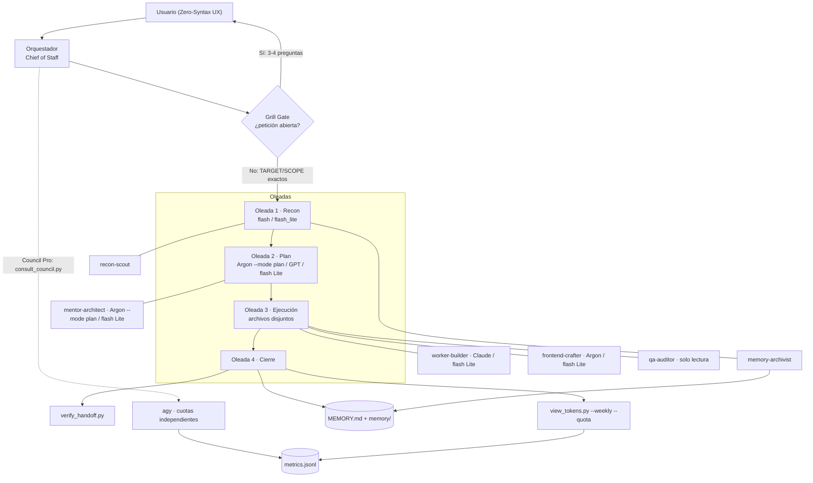

# 🎖️ Chief of Staff (v1.1)

> Plugin de orquestación multi-agente para **Antigravity (`agy`)**: un coordinador ligero con **Modo Dual (Student Lite & Council Pro)**, **Semáforo de Cuotas**, **Zero-Syntax UX** y verificación determinista en cada entrega.

[](LICENSE)

## ¿Qué es?

Chief of Staff convierte al modelo principal en un **coordinador**, no en un obrero. Se apoya en cinco pilares:

| Pilar | Qué hace |
|-------|----------|
| **Micro-Kernel v5.1** | Reglas mínimas y deterministas (`rules/AGENTS.md`) que cargan solo el contexto necesario y definen el ruteo; todo lo demás vive en skills y playbooks bajo demanda. |
| **Modo Dual (Student Lite vs Council Pro)** | Opera tanto en cuentas universitarias/estándar usando solo subagentes `flash`/`flash_lite` (**Student Lite**) como en entornos multi-modelo delegando a Claude 5.5, Argon 4 y GPT-OSS (**Council Pro**). |
| **Semáforo de Cuotas** | Audita el consumo diario y semanal (`--daily`, `--weekly`, `--quota`) frente a `quota_budget.json` para rotar de familia o activar modo ahorro antes de agotar tokens Pro. |
| **Oleadas & Grill Gate** | Aclara requisitos ambiguos con 3-4 preguntas cortas (*Grill Gate*) y ejecuta en 4 fases: Recon paralelo → Plan → Ejecución en archivos disjuntos → Cierre verificado. |
| **Context Sharding & Zero-Syntax UX** | Memoria persistente en fichas atómicas (<80 líneas) indexadas en `MEMORY.md`, manejable con frases naturales sin escribir rutas ni flags. |

Cada builder cierra con `verify_handoff.py` (sintaxis limpia + cero violaciones de scope git) y un `HANDOFF_PACKET`.

## Modo Dual: Student Lite vs Council Pro

| Característica | 🎓 Student Lite (`COS_PROFILE=lite` o sin `agy`) | 🏛️ Council Pro (por defecto con CLI `agy`) |
|----------------|--------------------------------------------------|--------------------------------------------|
| **Requisitos** | Solo `python3 >= 3.10` y `git` (`agy` opcional) | `python3 >= 3.10`, `git` y CLI `agy` en `PATH` |
| **Exploración y Memoria** | `invoke_subagent` (`flash` / `flash_lite`) | `invoke_subagent` (`flash` / `flash_lite`) |
| **Coding, UI y QA** | `invoke_subagent` (`flash` / `flash_lite`) | `consult_council.py` (Claude 5.5, Argon 4, GPT-OSS) |
| **Gasto de cuota Pro/Principal** | **0%** (protección total de cuota principal) | **Mínimo** (repartido en cuotas independientes) |
| **Grill Gate, Oleadas y `verify_handoff.py`** | Incluidos | Incluidos |

## Arquitectura



## Ruteo de modelos y agentes (7 especialistas)

| Tipo de tarea | Agente | Vía Council Pro | Vía Student Lite |
|---------------|--------|-----------------|------------------|
| Exploración, lectura, logs, coordenadas AST | `recon-scout` (Vega) | `invoke_subagent` (`flash` / `flash_lite`) | `invoke_subagent` (`flash` / `flash_lite`) |
| Fichas de memoria, `MEMORY.md` e Instincts | `memory-archivist` (Clío) | `invoke_subagent` (`flash_lite` / `flash`) | `invoke_subagent` (`flash_lite` / `flash`) |
| Arquitectura, diseño de sistemas, mentoría (Oleada 2) | `mentor-architect` (Marco) | `consult_council.py -m argon --agent mentor-architect --mode plan` | `invoke_subagent` (`flash`) |
| Coding, refactor, debug, tests | `worker-builder` (Mateo) | `consult_council.py -m claude --agent worker-builder --exec` | `invoke_subagent` (`flash`) |
| Frontend, UI/UX, CSS, 3D web | `frontend-crafter` (Elena) | `consult_council.py -m argon --agent frontend-crafter --exec` / `--mode plan` | `invoke_subagent` (`flash`) |
| QA independiente (solo lectura) | `qa-auditor` (Nadia) | `consult_council.py -m claude --agent qa-auditor --mode plan --sandbox` | `invoke_subagent` (`flash`) |
| Seguridad defensiva / OSINT autorizado | `cyber-auditor` (Specter) | `consult_council.py -m claude --agent cyber-auditor --mode plan --sandbox` (o `claude-opus`) | `invoke_subagent` (`flash`) |
| Segunda opinión / desempate | — | `consult_council.py -m gpt` | `invoke_subagent` (`flash`) |

> **Auto-ruteo con fallback de cuotas**: Usa `-m auto --agent <agente> [--task <tipo>] --auto-fallback` para elegir automáticamente el modelo óptimo según el especialista/tarea y rotar de familia si el Semáforo de Cuotas marca `CRITICAL` (añade `--dry-run-route` para inspeccionar la decisión sin ejecutar). Lista completa de alias: `python3 skills/chief-of-staff-ops/scripts/consult_council.py --list-models`.

## Lo mejor de ECC y Ruflo (sin bloat)

Chief of Staff destila cuatro prácticas probadas de **Everything Claude Code (ECC)** y **Ruflo**, implementadas en Python estándar sin dependencias externas ni daemons pesados:

- **Guardrails Python & Daemons (`playbooks/python_daemon_guardrails.md`)**: disciplina anti-fugas con `subprocess` acotado por `timeout`, escrituras atómicas, manejo explícito de señales y prohibición de procesos huérfanos.
- **Secret-Scan en `verify_handoff.py`**: además de validar sintaxis (Python, Bash, JSON) y scope git, bloquea en modo *fail-closed* cualquier entrega que filtre API keys, tokens o secretos en archivos modificados.
- **Instincts con `confidence` (`memory-archivist`)**: lecciones operativas y patrones del proyecto guardados como fichas atómicas en `memory/` con puntaje de confianza (`confidence: 0.3–0.9`), permitiendo consolidar aprendizajes reales sin inflar el prompt base.
- **Búsqueda local FTS5 (`memory_search.py`)**: índice SQLite FTS5 de cero dependencias externas para buscar por relevancia en `MEMORY.md` y `memory/` antes de lanzar exploraciones costosas.

## Zero-Syntax UX

No necesitas recordar rutas ni comandos. Habla en lenguaje natural y el Chief of Staff ejecuta la herramienta correspondiente:

| Si le dices al Chief of Staff... | Ejecuta internamente... |
|----------------------------------|-------------------------|
| *"¿Cómo voy de cuota esta semana?"* | `view_tokens.py --weekly --quota` (Semáforo de Cuotas) |
| *"¿Cuánto he gastado hoy?"* | `view_tokens.py --daily --quota` |
| *"Revisa mi proyecto y dime por dónde empezar"* | `recon-scout` (`flash`) + `ast_outline.py` |
| *"Haz un plan paso a paso / explícame la arquitectura"* | Grill Gate (`ask_question`) + Oleada 2 con `mentor-architect` (`--mode plan` o `flash`) |
| *"Resuélvelo en modo estudiante / ahorro"* | Modo Student Lite (`COS_PROFILE=lite`, subagentes `flash`) |
| *"Verifica mis cambios y dime si todo compila limpio"* | `verify_handoff.py --scope <archivos>` (sintaxis + scope git + secret-scan) |
| *"Busca o guarda esta decisión en memoria"* | `memory_search.py "<query>"` / `memory-archivist` (`flash_lite`) → `MEMORY.md` + `memory/` |

## Estructura del repositorio

```text
chief-of-staff/
├── .github/
│   └── workflows/
│       └── ci.yml                   # Pipeline CI (linting, unit tests y smoke checks)
├── agents/                          # 7 perfiles especializados:
│   ├── recon-scout.md               #   Vega (exploración rápida y coordenadas AST)
│   ├── memory-archivist.md          #   Clío (fichas atómicas, MEMORY.md e Instincts)
│   ├── mentor-architect.md          #   Marco (arquitectura, Oleada 2 y mentoría socrática)
│   ├── worker-builder.md            #   Mateo (implementación backend y scripts)
│   ├── frontend-crafter.md          #   Elena (UI/UX, CSS y 3D web)
│   ├── qa-auditor.md                #   Nadia (auditoría QA independiente solo lectura)
│   └── cyber-auditor.md             #   Specter (seguridad defensiva y OSINT autorizado)
├── rules/
│   └── AGENTS.md                    # Micro-Kernel v5.1: Modo Dual, ruteo, Semáforo y Zero-Syntax UX
├── skills/
│   └── chief-of-staff-ops/
│       ├── SKILL.md                 # Protocolo operativo v5.1
│       └── scripts/
│           ├── consult_council.py   # Invoca modelos (-m auto/--auto-fallback/--dry-run-route/--agent)
│           ├── verify_handoff.py    # Sintaxis (Py/Bash/JSON) + scope git + secret-scan, fail-closed
│           ├── view_tokens.py       # Telemetría y Semáforo de Cuotas (--daily/--weekly/--quota)
│           ├── memory_search.py     # Búsqueda local SQLite FTS5 en MEMORY.md y memory/
│           ├── ast_outline.py       # Esqueleto AST con números de línea
│           └── shard_doc.py         # Troceado de Markdown en fichas (<80 líneas)
├── playbooks/
│   ├── briefing_contract.md         # Contrato Sniper Briefing (5 líneas) y HANDOFF_PACKET
│   ├── model_quota_dossier.md       # Expediente de cuotas, familias de modelos y rotación
│   ├── python_daemon_guardrails.md  # Guardrails para scripts Python, daemons y subprocesos
│   └── teamwork_waves.md            # Orquestación por Oleadas (1 Recon → 2 Plan → 3 Exec → 4 Cierre)
├── templates/
│   ├── GEMINI.md.example            # Doctrina Global v5.0 genérica
│   ├── MEMORY.md.example            # Índice de memoria inicial
│   ├── mcp_config.example.json      # Configuración MCP de ejemplo
│   └── quota_budget.example.json    # Presupuesto semanal/diario para el Semáforo de Cuotas
├── tests/
│   └── test_chief_of_staff.py       # Suite de tests unitarios (ruteo, cuotas, FTS5, handoff)
├── plugin.json                      # Manifiesto v1.1.0 y prompts Zero-Syntax sugeridos
├── install.sh                       # Instalador con onboarding (--student) y diagnóstico (--doctor)
├── .gitignore
├── LICENSE
└── README.md
```

## Instalación rápida

Requisitos: `bash`, `python3` ≥ 3.10 y `git` (`agy` es opcional: si no está instalado, activa automáticamente **Student Lite**).

```bash
git clone https://github.com/zzzhama/chief-of-staff.git
cd chief-of-staff
bash install.sh --student       # instala, inicializa GEMINI.md + quota_budget.json y corre --doctor
```

Opciones de `install.sh`:

| Opción | Efecto |
|--------|--------|
| `--student` | **Recomendado para empezar**: ejecuta `--copy` + `--init-config` + crea `quota_budget.json` si falta + `--doctor`. |
| `--doctor` | Valida `python3 >= 3.10`, `git`, presencia opcional de `agy` (aviso Student Lite), `GEMINI.md` y `quota_budget.json`. |
| `--copy` | Copia los componentes al directorio del plugin (por defecto). |
| `--link` | Enlaza simbólicamente los componentes al repo (desarrollo: cambios al instante). |
| `--init-config` | Crea `~/.gemini/GEMINI.md`, `mcp_config.json` y `quota_budget.json` desde `templates/` **solo si no existen**. |

`install.sh` es idempotente: **nunca** sobrescribe `MEMORY.md`, `memory/`, `metrics.jsonl`, `mcp_config.json` ni `quota_budget.json` existentes. Variables opcionales: `GEMINI_HOME` y `COS_TARGET`.

## Semáforo de Cuotas y Uso CLI

Ruta base de los scripts (`S`):

```bash
S=~/.gemini/config/plugins/chief-of-staff/skills/chief-of-staff-ops/scripts
```

```bash
# Semáforo de Cuotas semanal o diario contra quota_budget.json
python3 $S/view_tokens.py --weekly --quota
python3 $S/view_tokens.py --daily --quota
python3 $S/view_tokens.py --last 10 --sessions 5

# Auto-ruteo inteligente con fallback automático por cuotas (y previsualización con --dry-run-route)
python3 $S/consult_council.py -m auto --agent worker-builder --task coding --auto-fallback --exec --dir /ruta/workspace \
  "TARGET: app.py | SCOPE: L20-L90 | OUTPUT: HANDOFF_PACKET | BUDGET: 4 | FORBID: fuera de scope"
python3 $S/consult_council.py -m auto --agent mentor-architect --auto-fallback --dry-run-route "Plan de arquitectura"

# Implementación con Claude (Council Pro), briefing tipado
python3 $S/consult_council.py -m claude --agent worker-builder --exec --dir /ruta/workspace \
  "TARGET: app.py | SCOPE: L20-L90 | OUTPUT: HANDOFF_PACKET | BUDGET: 4 | FORBID: fuera de scope"

# Diseño de arquitectura y plan de oleadas (Oleada 2) con Marco (mentor-architect) en Argon
python3 $S/consult_council.py -m argon --agent mentor-architect --mode plan --dir /ruta/workspace \
  "TARGET: arquitectura | SCOPE: diseño modular y trade-offs | OUTPUT: plan de oleadas"

# QA independiente de solo lectura
python3 $S/consult_council.py -m claude --agent qa-auditor --mode plan --sandbox --dir /ruta/workspace \
  "TARGET: tests/ | OUTPUT: PASS/FAIL"

# Búsqueda local FTS5 en memoria y verificación determinista (sintaxis + scope + secret-scan)
python3 $S/memory_search.py "cuotas"
python3 $S/verify_handoff.py --scope archivo1.py archivo2.sh
```

Variables útiles: `COS_PROFILE=lite` fuerza Modo Student Lite; `COS_METRICS_PATH` redirige `metrics.jsonl`.

## Tests & CI

La suite de pruebas unitarias valida el auto-ruteo y fallback de cuotas (`consult_council.py`), el Semáforo de Cuotas (`view_tokens.py`), la verificación y secret-scan (`verify_handoff.py`), la búsqueda FTS5 (`memory_search.py`) y las utilidades AST/sharding, ejecutándose automáticamente en GitHub Actions (`.github/workflows/ci.yml`):

```bash
python3 -m unittest discover -s tests -v
```

## Privacidad

`MEMORY.md`, `memory/*.md`, `metrics.jsonl`, `mcp_config.json`, `quota_budget.json` y `.env` permanecen locales en tu instalación y no se suben al repositorio.

## Licencia

[MIT](LICENSE) © 2026 zzzhama
